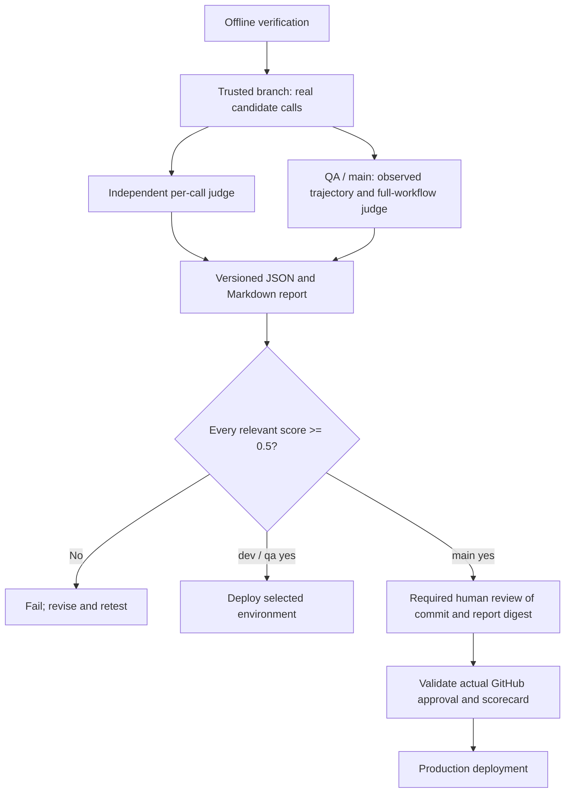

# Agent evaluation and release gates

The support assistant is evaluated by the same server adapter and chat handler used by the site. Trusted branch builds run actual candidate model calls and an independent model judge. Offline regression tests verify the harness and fail-closed behavior; they do not establish model quality. No evaluation or deployment has been run against production as part of this implementation.

| Branch       | Required evaluation                                                   | Release condition                                                                                        |
| ------------ | --------------------------------------------------------------------- | -------------------------------------------------------------------------------------------------------- |
| `dev`        | Component: every observed support-model call                          | Every relevance, faithfulness and task-completion score is at least **0.5**                              |
| `qa`         | Trajectory: complete server workflows, plus every observed model call | Every component dimension and full-trajectory dimension is at least **0.5**; critical guards pass        |
| `main`       | Both suites, then recorded human evaluation                           | Automated gates pass and a human approves the exact commit/report with all human scores at least **0.5** |
| Pull request | Offline unit, browser, security and build checks                      | No provider or deployment secrets; trusted branch builds run the live quality gates                      |

There is no averaging across calls, cases or dimensions. A score of exactly 0.5 passes. Missing coverage, a new unregistered component, invalid/out-of-range grades, provider/judge failures or missing human evidence fail the job. CI never rewrites prompts or overrides a failed guard. Fix the prompt, code, reference or harness as appropriate, then rerun the failed candidate.



## Support inventory and evidence

`evals/support/cases.json` versions the public facts and expected behavior for service questions, unsupported service guarantees, account boundaries and prompt injection. The component inventory currently contains `support.answer`. Each intercepted candidate request must belong to that inventory and receive a valid grade.

QA calls the actual session handler, signed visitor cookie logic, chat handler, local Netlify Blobs SDK, rate limiter, CAPTCHA verification path and Open WebUI adapter. The handler's opt-in observer emits only stage, outcome, status and elapsed time. The expected successful order is validation → session → rate-limit storage → CAPTCHA → provider → response. Missing consent, cross-origin requests and missing sessions must be rejected without any candidate call. The full-workflow judge also assesses the visible answer and observed sequence.

The local Blobs server uses a new temporary directory and random credentials. CAPTCHA returns a synthetic verified result. Only the configured public-support provider receives real candidate requests; questions contain public synthetic test data. The suite never writes inquiries, sends emails or changes subscriber/account records. It does not prove Cloudflare connectivity, deployed Netlify storage, browser interactions, or hidden retrieval/tool behavior inside Open WebUI. Existing browser and HTTP checks remain separate. Evaluate provider-side retrieval traces separately if those become available; do not label hidden reasoning as trajectory evidence.

Component and trajectory evidence includes visible test outputs, scores, rationales and safe stage traces. It excludes private provider settings, credentials, hidden reasoning and customer transcripts. `artifacts/agent-evals/` is ignored. GitHub retains automated evidence for 14 days and human records for 30 days; restrict repository/artifact access appropriately.

## Configure GitHub

1. In the `dev`, `qa` and `prod` GitHub environments, configure the existing dedicated public-support `OPENWEBUI_*` settings and these three new **secrets**: `AI_EVAL_JUDGE_URL` (full HTTPS OpenAI-compatible chat-completions endpoint, no URL credentials/query), `AI_EVAL_JUDGE_API_KEY`, and `AI_EVAL_JUDGE_MODEL`. Use a suitable independent judge, rather than the support assistant/knowledge agent itself. The endpoint must support JSON-object output and the configured request parameters. These settings are CI-only and are not synchronized to Netlify.
2. Create the **`agent-production-review`** environment in Settings → Environments. Add required human reviewers, prevent self-review where available, disable administrator bypass where available, and limit deployment branches to `main`. Ensure your GitHub repository visibility/plan supports required reviewers. Without actual recorded approval, the post-review check fails even if an unprotected environment lets the job start. No fallback automatically approves production.
3. Require the verification and evaluation checks in branch protection/rulesets as appropriate. PRs run offline checks; live scores are required on trusted branch pushes. Keep production deployment through this gated workflow, and disable any independent Netlify Git auto-publish path that could bypass it.

The workflow uses `contents: read`; the human-verification job additionally uses `actions: read` to read approval history. There are no model/deployment credentials on forked PRs. New components must be registered with meaningful cases before their calls can pass coverage checks.

## Human production review

After the main-branch automatic gate passes, open the `agent-evaluation` artifact and inspect `report.json` and `report.md`. Check factual support, uncertainty, refusals, account boundaries, full-flow evidence, and any judge disagreement. The Markdown report contains a scorecard template with the SHA-256 of the exact JSON bytes. Replace all placeholder scores and notes with your own assessment.

Approve `agent-production-review` in the workflow's **Review deployments** dialog and paste that completed JSON object as the review comment. Keep the keys `report_sha256`, `decision`, `scores` (`relevance`, `faithfulness`, `trajectory`), and `notes`. Notes need at least 20 characters. Any human score below 0.5 means reject and revise. Approval without a complete scorecard, approval of another artifact/commit, a bot approval, or an environment bypass cannot release production. `evals/human-review.mjs` verifies GitHub's actual approval history, this run's report digest and source commit before emitting `human-evaluation.json`.

This review approves a website code/model evaluation candidate. It does not approve individual future customer interactions or grant the bot additional capabilities.

## Local commands and maintenance

With the candidate settings, independent judge settings and explicit public-support enablement supplied in an ignored environment file or shell:

```sh
node --env-file=.env.local --import tsx evals/run.mjs component
node --env-file=.env.local --import tsx evals/run.mjs trajectory
npm run eval:all
```

The npm scripts read inherited environment variables; they do not implicitly load secrets. These commands incur candidate and judge usage. Reports are written even when setup fails, and the command exits nonzero. Do not use customer data or a privileged internal-knowledge account. Before trusting a new judge/model, compare its grading against reviewed examples, including known bad answers; passing harness tests is not judge calibration.

The CrewAI editorial repository has its own `docs/agent-evaluations.md`, flow inventory, runtime observer and gated release workflow. The shared `core.mjs` and `human-review.mjs` are vendored so each repository runs independently; update their offline gate tests in both repositories when changing the scoring contract.
