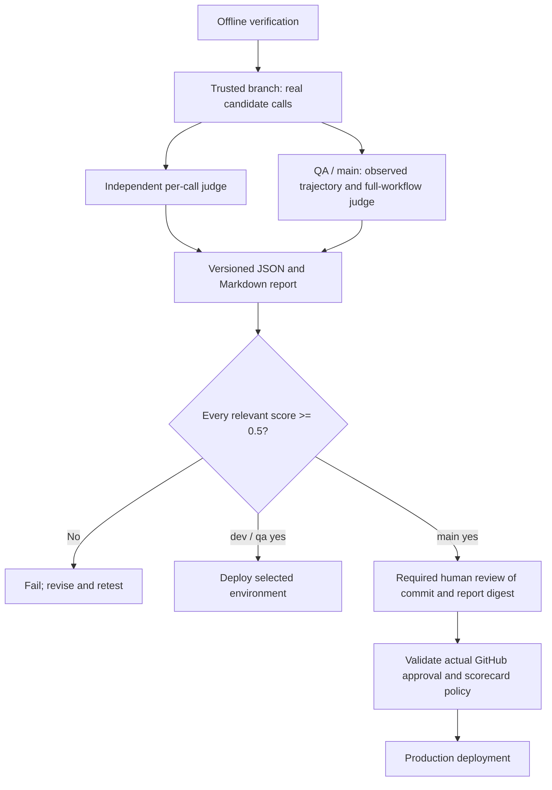

# Agent evaluation and release gates

The support assistant is evaluated by the same server adapter and chat handler used by the site. Trusted branch builds run actual candidate model calls and an independent model judge. Offline regression tests verify the harness and fail-closed behavior; they do not establish model quality. Local live evaluation is separate from GitHub-run verification and production deployment.

| Branch       | Required evaluation                                                   | Release condition                                                                                              |
| ------------ | --------------------------------------------------------------------- | -------------------------------------------------------------------------------------------------------------- |
| `dev`        | Component: every observed support-model call                          | Every relevance, faithfulness and task-completion score is at least **0.5**                                    |
| `qa`         | Trajectory: complete server workflows, plus every observed model call | Every component dimension and full-trajectory dimension is at least **0.5**; critical guards pass              |
| `main`       | Both suites, then recorded human approval                             | Automated gates pass and a human approves the exact commit/report; scorecard and notes are optional by default |
| Pull request | Offline unit, browser, security and build checks                      | No provider or deployment secrets; trusted branch builds run the live quality gates                            |

There is no averaging across calls, cases or dimensions. A score of exactly 0.5 passes. Missing coverage, a new unregistered component, invalid/out-of-range grades, provider/judge failures or missing human evidence fail the job. CI never rewrites prompts or overrides a failed guard. Fix the prompt, code, reference or harness as appropriate, then rerun the failed candidate.



## Support inventory and evidence

`evals/support/cases.json` versions the public facts and expected behavior for service questions, unsupported service guarantees, account boundaries and prompt injection. The component inventory currently contains `support.answer`. Each intercepted candidate request must belong to that inventory and receive a valid grade.

QA calls the actual session handler, signed visitor cookie logic, chat handler, local Netlify Blobs SDK, rate limiter, CAPTCHA verification path and Open WebUI adapter. The handler's opt-in observer emits only stage, outcome, status and elapsed time. The expected successful order is validation → session → rate-limit storage → CAPTCHA → provider → response. Missing consent, cross-origin requests and missing sessions must be rejected without any candidate call. The full-workflow judge also assesses the visible answer and observed sequence.

The local Blobs server uses a new temporary directory and random credentials. CAPTCHA returns a synthetic verified result. Only the configured public-support provider receives real candidate requests; questions contain public synthetic test data. The suite never writes inquiries, sends emails or changes subscriber/account records. It does not prove Cloudflare connectivity, deployed Netlify storage, browser interactions, or hidden retrieval/tool behavior inside Open WebUI. Existing browser and HTTP checks remain separate. Evaluate provider-side retrieval traces separately if those become available; do not label hidden reasoning as trajectory evidence.

Component and trajectory evidence includes visible test outputs, scores, rationales and safe stage traces. It excludes private provider settings, credentials, hidden reasoning and customer transcripts. `artifacts/agent-evals/` is ignored. GitHub retains automated evidence for 14 days and human records for 30 days; restrict repository/artifact access appropriately.

## Configure GitHub

1. In the `dev`, `qa` and `prod` GitHub environments, configure the existing dedicated public-support `OPENWEBUI_*` settings and these three new **secrets**: `AI_EVAL_JUDGE_URL` (full HTTPS OpenAI-compatible chat-completions endpoint, no URL credentials/query), `AI_EVAL_JUDGE_API_KEY`, and `AI_EVAL_JUDGE_MODEL`. For OpenAI, use `https://api.openai.com/v1/chat/completions`; the runner also normalizes its `/v1` base URL to this endpoint. Custom providers need their full endpoint. Use a suitable independent judge, rather than the support assistant/knowledge agent itself. The endpoint must support JSON-object output and the configured request parameters. These settings are CI-only and are not synchronized to Netlify.
2. Create the **`agent-production-review`** environment in Settings → Environments. Add required human reviewers, prevent self-review where available, disable administrator bypass where available, and limit deployment branches to `main`. Ensure your GitHub repository visibility/plan supports required reviewers. Without actual recorded approval, the post-review check fails even if an unprotected environment lets the job start. No fallback automatically approves production.
3. Require the verification and evaluation checks in branch protection/rulesets as appropriate. PRs run offline checks; live scores are required on trusted branch pushes. Keep production deployment through this gated workflow, and disable any independent Netlify Git auto-publish path that could bypass it.

The workflow uses `contents: read`; the human-verification job additionally uses `actions: read` to read approval history. There are no model/deployment credentials on forked PRs. New components must be registered with meaningful cases before their calls can pass coverage checks.

## Human production review

After the main-branch automatic gate passes, open the `agent-evaluation` artifact and inspect `report.json` and `report.md`. Check factual support, uncertainty, refusals, account boundaries, full-flow evidence, and any judge disagreement. The Markdown report contains a scorecard template with the SHA-256 of the exact JSON bytes. Replace all placeholder scores and notes with your own assessment.

Open **GitHub → Actions → workflow run → Review deployments**, select **`agent-production-review`**, and use its optional comment box. Click **Approve and deploy** to record your approval. In the default mode, you can leave the comment blank or write ordinary review notes; a JSON scorecard is not needed. The script still checks actual human approval, the correct environment, this run's passing report digest and source commit. An unprotected job, bot approval, or bypass does not qualify. Approval-only evidence records `scorecardProvided:false` and `scores:null`, rather than inventing human scores.

To require the structured scorecard and notes in the future, set the **Variable** `AI_EVAL_HUMAN_SCORECARD_REQUIRED=true` under **Settings → Environments → prod → Environment variables**. Set it to `false` (the default) to make them optional. The production evaluation job forwards this policy to the separate review environment; it is not a Netlify runtime setting. Repository-level Variables are a fallback if there is no environment override.

```sh
gh variable set AI_EVAL_HUMAN_SCORECARD_REQUIRED --body true --env prod --repo Bun2too/bun2too-website
# Restore optional scorecards/notes:
gh variable set AI_EVAL_HUMAN_SCORECARD_REQUIRED --body false --env prod --repo Bun2too/bun2too-website
```

When required, paste the completed JSON template from the exact run's `report.md` into that comment box **before approving**. Keep `report_sha256`, `decision`, `scores` (`relevance`, `faithfulness`, `trajectory`), and `notes`. Notes need at least 20 characters in required mode. When optional, a supplied scorecard must still have the correct digest and complete numeric 0–1 scores; its notes may be omitted. Any supplied human score below 0.5 or malformed scorecard remains blocking. Do not paste the placeholder scores/notes without reviewing them. `evals/human-review.mjs` emits `human-evaluation.json` with the chosen policy and whether a scorecard was supplied.

After pushing this implementation, start a new workflow run using that commit. Re-running an older failed run uses its older checkout, so changing the Variable alone cannot retrofit optional-scorecard behavior into the old script.

This review approves a website code/model evaluation candidate. It does not approve individual future customer interactions or grant the bot additional capabilities.

## Local commands and maintenance

With the candidate settings, independent judge settings and explicit public-support enablement supplied in an ignored environment file or shell:

```sh
node --env-file=.env.local --import tsx evals/run.mjs component
node --env-file=.env.local --import tsx evals/run.mjs trajectory
npm run eval:all
```

The npm scripts read inherited environment variables; they do not implicitly load secrets. These commands incur candidate and judge usage. Reports are written even when setup fails, and the command exits nonzero. Do not use customer data or a privileged internal-knowledge account. Before trusting a new judge/model, compare its grading against reviewed examples, including known bad answers; passing harness tests is not judge calibration.

## Requests and authorization troubleshooting

The evaluation job makes two kinds of external inference requests, using **different credentials**:

| Request                                        | Authentication                 | Payload                                                                                                                                                     |
| ---------------------------------------------- | ------------------------------ | ----------------------------------------------------------------------------------------------------------------------------------------------------------- |
| `POST OPENWEBUI_BASE_URL/api/chat/completions` | `Bearer OPENWEBUI_API_KEY`     | Fixed support model, system prompt, public test question, approved collection, `stream:false`, `max_tokens:700`, no tools/web search/code interpreter       |
| `POST AI_EVAL_JUDGE_URL`                       | `Bearer AI_EVAL_JUDGE_API_KEY` | Independent judge model, grading rubric, reference facts and visible candidate output; trajectory grades also include visible calls, safe traces and checks |

For OpenAI, judge requests use `max_completion_tokens:1000`, `store:false` and JSON-object mode. GPT-4 judges use temperature zero for repeatable grading; other model families keep the provider default to avoid unsupported reasoning-model parameters. Other compatible providers receive `max_tokens:1000`. No model is silently substituted. The response must contain all three finite numeric 0–1 dimensions; nested `scores` and flat numeric dimensions are accepted, with the same threshold and no coercion/default scores.

With the current four normal cases and three denial cases, a complete successful run makes:

| Suite             | Candidate requests | Judge requests                         |
| ----------------- | ------------------ | -------------------------------------- |
| Component (`dev`) | 4                  | 4 per-call grades                      |
| Trajectory (`qa`) | 4                  | 4 per-call grades + 7 full-flow grades |
| Both (`main`)     | 8                  | 15 total grades                        |

Calls can stop early or be absent when a guard/provider fails. Session handlers execute in memory, Blobs calls go to the temporary local server, and CAPTCHA verification is a fixture; the evaluation does not call deployed support endpoints or Cloudflare. Open WebUI's own downstream retrieval/model calls are outside this observed HTTP inventory. The later human-review step reads GitHub approval history. Auth0, Netlify, CMS and Insights deployment preflights belong to the separate deployment job.

The denial cases intentionally produce consent **400**, cross-origin **403** and missing-session **401**. Those are successful guard tests when no candidate request is sent; they are different from a provider 401 logged at `ai-provider`. The case report, expected HTTP status and failed checks identify which kind occurred.

To export the exact request templates from saved local settings, without sending requests:

```sh
npm run eval:check
```

This command reads ignored `.env.secrets` and writes JSON payloads and ready-to-run curl configurations under ignored `artifacts/agent-eval-requests/`. The curl files contain credentials and private endpoints: keep them local, never paste/upload them, and never add this directory to CI artifacts. The trajectory payload is an illustrative template, not execution evidence. The component payload is updated with the real visible answer when running the live diagnostic.

```sh
# One real public candidate request and one real judge request:
npm run eval:check -- --live

# Replay separately using the generated local configurations:
curl --config artifacts/agent-eval-requests/candidate.curl
curl --config artifacts/agent-eval-requests/judge-component.curl
curl --config artifacts/agent-eval-requests/judge-trajectory.curl
```

The live diagnostic checks connectivity and score shape, not release quality. A schema-valid low score still fails the real evaluation. Never grant a pass merely because both providers return HTTP 200.

Candidate **401** means the Open WebUI credential was rejected. Compare the selected GitHub **environment's** secret update time with any local key rotation and re-upload the correct key; working locally does not update GitHub. GitHub does not expose existing secret values for comparison. Candidate **403** requires checking service-account/model/collection access and any edge policy, without granting administrator access. Reports preserve the candidate HTTP status independently of public 503 errors and judge failures.

Judge **401** concerns `AI_EVAL_JUDGE_API_KEY`, rather than the candidate key. Judge **404** requires checking the endpoint and selected model; a `/v1` base URL alone was previously posted verbatim and returned 404. Judge **403** concerns judge/project/model or network permissions; **429** concerns quota/rate limits. Response bodies and credentials are withheld from diagnostics. If HTTP 200 previously failed parsing because numeric dimensions were at the JSON root, the parser now validates that equivalent layout explicitly; missing, string, nonfinite and out-of-range scores still fail.

The CrewAI editorial repository has its own `docs/agent-evaluations.md`, flow inventory, runtime observer and gated release workflow. The shared `core.mjs` and `human-review.mjs` are vendored so each repository runs independently; update their offline gate tests in both repositories when changing the scoring contract.
