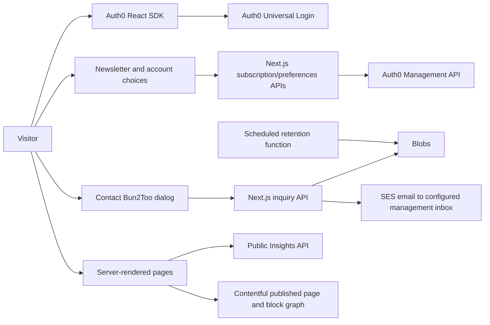

# Site architecture and feature inventory

This is a Next.js App Router application with server-rendered public content and client-side Auth0 authentication. Netlify hosts pages, Next.js API handlers, static assets, and a scheduled retention function. Static export is unsuitable because identity preferences, support, and private inquiry collection use server code.

Contentful owns published public page content and block composition through seven content types. `src/content/website-seed.json` is the migration/fallback snapshot; `contentful.ts` reads the Delivery API server-side and `CmsBlocks.tsx` renders the existing design. Core public routes use `ContentPage`; `[...slug]` serves additional validated public CMS paths without taking over private/application routes. Navigation/footer, page metadata, service/FAQ schema, sitemap and `/llms.txt` consume the CMS graph. Insights article records remain external. See the [Contentful design](contentful-design.md) for model/field details, diagrams, caching, failure policy and publishing evidence.

## Views and discovery routes

| Route                         | View or behavior                                                                                                 | Main source                                                                   |
| ----------------------------- | ---------------------------------------------------------------------------------------------------------------- | ----------------------------------------------------------------------------- |
| `/`                           | Brand hero, featured AI services, customer technology, approach, Insights promotion, newsletter, contact CTA     | `src/app/page.tsx`                                                            |
| `/services`                   | Six capabilities: AI engineering, AI environments, CDP, CIAM, analytics, and consent; supporting fintech content | `src/app/services/page.tsx`, `src/components/Services.tsx`, `src/lib/site.ts` |
| `/process`                    | Discover/design/deliver/evolve process and CTA                                                                   | `src/app/process/page.tsx`, `src/components/Process.tsx`                      |
| `/usecases`                   | Illustrative AI delivery, infrastructure, customer technology, and fintech scenarios                             | `src/components/UseCases.tsx`                                                 |
| `/contact`                    | Private inquiry entry, optional configured email link, account and newsletter entry                              | `src/app/contact/page.tsx`                                                    |
| `/account`                    | Auth0 sign-in/signup/logout, profile, verified subscription confirmation, topic choices, withdrawal              | `src/components/Account.tsx`                                                  |
| `/insights`                   | Server-rendered public article index, RSS/Atom links, browser reading/update features, newsletter                | `src/app/insights/page.tsx`, `src/components/InsightUpdates.tsx`              |
| `/insights/[id]`              | Server-rendered article, editorial artwork, sources, article metadata/JSON-LD, newsletter                        | `src/app/insights/[id]/page.tsx`                                              |
| `/insights/signup`            | Reusable consent form embedded only by approved origins; header/footer/support launcher hidden                      | `src/app/insights/signup/page.tsx`, `src/styles/insights.css`                 |
| `/support`                    | Public FAQ page and entry points for private inquiries                                              | `src/app/support/page.tsx`, `src/lib/support-content.ts`                      |
| `/privacy`                    | Identity, consent, provider, inquiry data and retention explanation                                      | `src/app/privacy/page.tsx`                                                    |
| `/cookies`                    | Storage inventory and preference settings entry | `src/app/cookies/page.tsx`, `src/components/CookieConsent.tsx` |
| `/terms`                      | Website-use terms for Bun2too, Inc., including AI limitations and Texas venue | `src/app/terms/page.tsx` |
| `/hero`, `/cta`, `/articles`  | Working legacy views; noindex with canonical links to primary destinations                                       | Corresponding `src/app/*/page.tsx`                                            |
| `/robots.txt`, `/sitemap.xml` | Production public crawling and canonical page/article discovery; staging exclusions                              | `src/app/robots.ts`, `src/app/sitemap.ts`                                     |
| `/llms.txt`                   | Optional public machine-readable overview and FAQs; excludes private records                                     | `src/app/llms.txt/route.ts`                                                   |
| `/og`                         | Branded 1200×630 PNG for social/search previews                                                                  | `src/app/og/route.tsx`                                                        |

The current canonical article experience is **bun2too.com/insights**. It uses a separate public editorial backend; `INSIGHTS_API_ORIGIN` is required private environment configuration without a source default. `https://insights.bun2too.com` is a related allowed embed origin, not a replacement for the current local route in `site.articles`. Preserve the integrated view and public backend boundary. See [Insights integration](insights.md).

## API and proxy map

| Method and path                                                      | Responsibility                                                                                   | Important boundary                                                                    |
| -------------------------------------------------------------------- | ------------------------------------------------------------------------------------------------ | ------------------------------------------------------------------------------------- |
| `POST /api/support/chat` | Optional single-question Open WebUI public support | Explicit enablement, fixed model/public collection, separate consent, session, CAPTCHA, limits; no transcript persistence |
| `POST /api/subscriptions`                                            | Validate consent/topics and create a pending, unverified passwordless email profile in Auth0     | Anonymous requests do not modify existing subscription choices                        |
| `GET /api/preferences`                                               | Read the signed-in user's newsletter preferences                                                 | Validated issuer/audience/client/scope access token                                   |
| `PATCH /api/preferences`                                             | Confirm topics or unsubscribe                                                                    | Email verification required for activation; never trust a browser-provided user ID    |
| `GET /api/support/session`                                           | Initialize a signed HttpOnly visitor cookie and report support configuration availability        | No saved inquiry records or credentials returned                                     |
| `POST /api/support/inquiries`                                        | Save a consented inquiry privately in Netlify Blobs and notify the management inbox through SES SMTP                                              | No marketing enrollment or chat attachment; no public inbox API   |
| `/api/insights/push-config`, `/api/insights/push-subscriptions`      | Proxy public Web Push setup/registration to editorial backend                                    | Preserve upstream public API; no marketing administration key                         |
| `/insights/feed.xml`, `/insights/feed.atom`, `/insights/unsubscribe` | Proxy feeds and unsubscribe handling to editorial backend                                        | Owned by the editorial service                                                        |

Fixed server proxy handlers own public feed/push/unsubscribe forwarding. `next.config.js` owns indexing response headers, and the signup frame-ancestor exception. The default frame policy excludes embedding elsewhere. Feed/digest delivery and Web Push are implemented in the editorial backend; this repository contains the website side and a push/click service worker without fetch interception.

## Data flow

## State and storage

| State                | Location and behavior                                                                                                          |
| -------------------- | ------------------------------------------------------------------------------------------------------------------------------ |
| Authentication       | Official Auth0 React SDK, browser memory; not a Next.js server session                                                         |
| Newsletter choices   | Auth0 server-owned `app_metadata.bun2too.newsletter`; pending → subscribed or unsubscribed                                     |
| Inquiry ownership       | Signed `bun2too_support` HttpOnly cookie; up to 24 hours, separate from Auth0 identity                                         |
| Inquiries            | Private `bun2too-support` store, `inquiries/`; name/email/topic/message/consent without chat attachments; expires after 90 days |
| Rate limits          | Pseudonymous keys under `limits/`, with conditional writes and expiry                                                          |
| Cookie choices       | Versioned host-only `bun2too_cookie_consent` cookie; 180 days; optional categories off by default; no account sync or server audit ledger |
| Reading/update state | Reading-list local storage only with optional preference permission; removed on withdrawal/expired consent on a visit. Push is a separate explicit browser opt-in. |

`CookieConsentProvider` wraps the identity provider and gates optional browser categories. `GoogleTagManager` initializes the environment-configured container only with Analytics consent, and controls advertising consent separately. Withdrawal targets known Google cookies and reloads to unload a previously running container. Necessary-only keeps authentication and requested support available. Consent never replaces terms acceptance, email consent, or inquiry permissions. See [terms/cookie behavior and legal review](legal-and-cookies.md).

`PageArtwork.tsx` owns the responsive artwork layout, with styles in `artwork.css`. CMS blocks can select published Contentful assets; the six local variants remain the fallback. Images are optimized WebP assets under `public/images/artwork`; the original architecture SVG remains available. `EmailButton.tsx` uses a stable server/client button to avoid extensions rewriting `mailto:` anchors before hydration. It opens the native configured mail handler only on click. See [visual design](visual-design.md) for the full asset/consumer/prompt map.

`netlify/functions/support-retention.mts` is scheduled daily at 04:00 UTC. It removes expired site records. Netlify packaging recognizes the schedule; production execution still depends on a deployed function and functioning storage access.

## Feature readiness

Source code, local builds, and mocked tests establish implementation behavior. Live Auth0 login/consent, email delivery, Web Push, inquiry persistence, DNS/domain configuration, and external search indexing each need their service configuration and live verification. Do not describe an integration as deployed, connected, or indexed based solely on these files. Setup references: [identity/deployment](setup.md), [support](support.md), [search](search.md), [Insights](insights.md).

Private inquiries are provider-independent. The former provider is removed; optional Open WebUI support uses a new configuration-gated server adapter and requires approved public knowledge/access configuration before activation. Legacy expired conversation records remain eligible for the existing retention cleanup; see [support](support.md).

## Optional public AI support

`POST /api/support/chat` accepts a single bounded question with separate explicit AI consent, signed visitor session and CAPTCHA. It uses server-only Open WebUI credentials, a fixed model and approved public knowledge collection; visitor input cannot select model, tools or documents. Private inquiry collection remains independent. The website stores no question/answer transcripts; configured providers may retain logs under their own policies. See [support setup](support.md) for access isolation, limits, retention and activation. Deployment troubleshooting and the configuration inventory are linked from [security](security.md).
