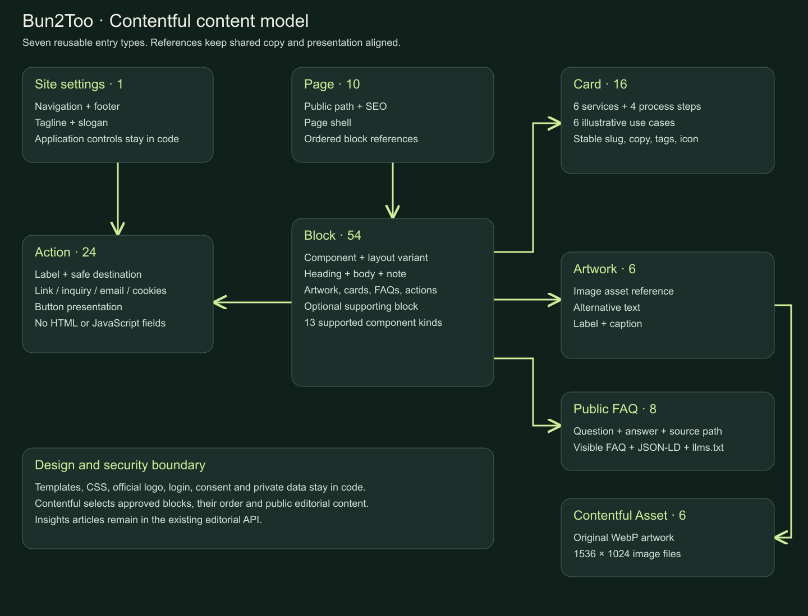
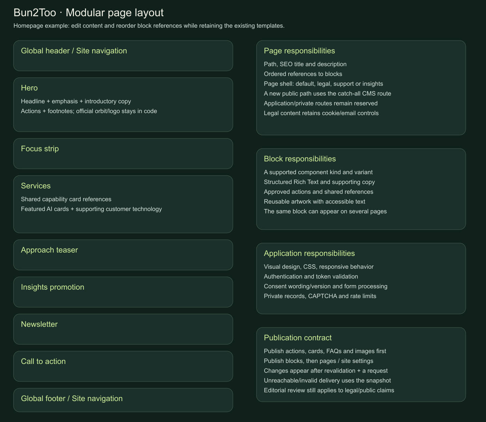
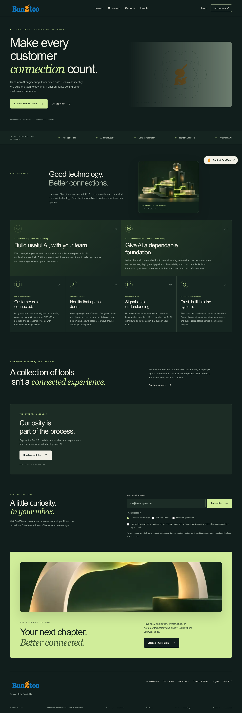
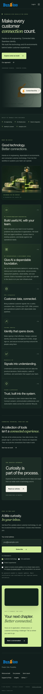
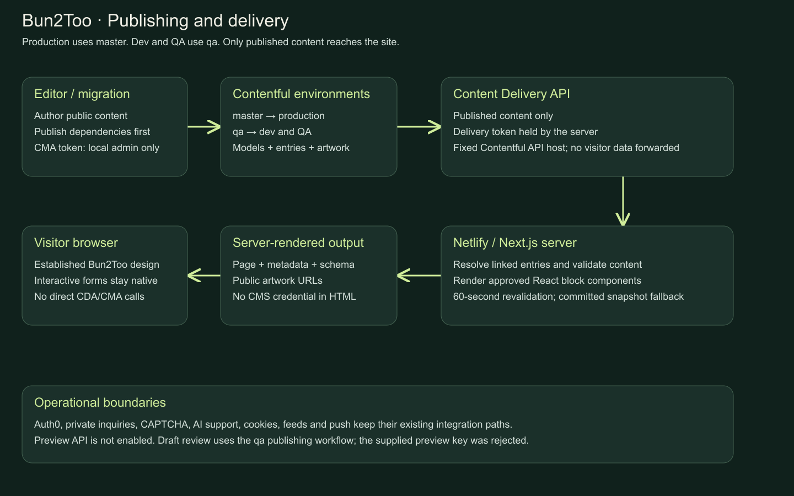

# Bun2Too Contentful CMS design and implementation

## Status and scope

The existing Bun2Too design is now represented by reusable Contentful entries and an application-owned React component library. Editors can change public copy, navigation, artwork, page SEO, supported layout variants, and block ordering without changing application code.

Publication was verified in both `master` and `qa`: seven activated content types, 119 published entries, six published artwork assets, and ten resolvable public pages per environment. A second seed run made no changes. An isolated local production build read the actual published QA content and rendered Contentful artwork successfully on desktop and mobile. Website publication to Netlify has not been performed as part of this change.

| Environment | Website destination | Purpose |
| --- | --- | --- |
| `master` | Production, branch `main` | Approved public website content |
| `qa` | Dev and QA, branches `dev` and `qa` | Editorial and integration review |

No actual space identifier, API token, tenant identifier, or private backend address is included in this document. Supply operational values through private environment settings.

## Design objectives

- Preserve the official logos, evergreen/cream/lime design, existing component classes, stable service anchors, and responsive behavior.
- Make shared content reusable through references rather than copying large page documents.
- Let a Page select and order supported Blocks; keep CSS, React implementation, and security behavior in versioned code.
- Render public content, metadata, service schema, FAQ schema, and discovery output on the server.
- Keep authentication, consent handling, private support records, AI configuration, and the existing Insights editorial service outside the CMS.
- Provide a committed fallback snapshot and a repeatable, non-destructive bootstrap publisher.

## Content model



The full machine-readable model is supplied in [contentful-model.json](contentful-model.json). The source definition is `scripts/contentful-model.mjs`.

| Content type | API ID | Initial entries | Responsibility |
| --- | --- | --- | --- |
| Site settings | `b2tSite` | 1 | Main navigation, footer navigation, tagline, slogan, legal links |
| Page | `b2tPage` | 10 | Public path, SEO, page shell, ordered block references |
| Block | `b2tBlock` | 54 | A supported component, variant, public copy, and references |
| Card | `b2tCard` | 16 | Six services, four process steps, six illustrative use cases |
| Action | `b2tAction` | 24 | Reusable navigation/CTA labels, destinations, presentation and approved interaction kinds |
| Artwork | `b2tArtwork` | 6 | Image reference, alternative text, label and caption |
| Public FAQ | `b2tFaq` | 8 | Question, answer and learn-more path |

Six Contentful image Assets hold the original WebP artwork. Assets are built-in Contentful entities, not an eighth custom content type. The official logo remains under `public/bun2too/`.

### Field design

| Type | Fields | Constraints and behavior |
| --- | --- | --- |
| Site | `name`, `key`, `tagline`, `slogan`, `navigation[]`, `footerLinks[]`, `legalLinks[]` | Singleton key is `website`; link arrays reference Actions |
| Page | `name`, `path`, `seoTitle`, `seoDescription`, `layout`, `blocks[]` | Unique public path; 1–60 block references; shells are `default`, `legal`, `support`, `insights` |
| Block | `name`, `kind`, `variant`, `anchor`, `eyebrow`, `heading`, `body`, `note`, `labels[]`, `artwork`, `items[]`, `faqs[]`, `actions[]`, `secondary` | Component and variant enums; typed Entry references; optional supporting block |
| Card | `name`, `slug`, `number`, `icon`, `eyebrow`, `title`, `body`, `detail`, `tags[]`, `featured` | Stable slug; application-owned icon vocabulary; featured capability flag |
| Action | `name`, `label`, `href`, `kind`, `variant` | Kinds: `link`, `inquiry`, `email`, `cookieSettings`; variants: `lime`, `outline`, `cream`, `text` |
| Artwork | `name`, `key`, `image`, `alt`, `label`, `caption` | Image Asset reference; accessible alternative text; safe Contentful image host |
| FAQ | `name`, `question`, `answer`, `path` | Answer is plain text; the same content feeds visible FAQs, schema and discovery |

`name` is the editorial display field. The initial locale is the environment's default locale (`en-US` in the supplied environments). The current application is single-language; multilingual routing and locale selection are not implemented.

Heading, body, and note use Contentful Rich Text. Supported output includes paragraphs, headings, emphasis, lists, tables, hyperlinks, and approved inline Action references. Rendering uses React elements rather than raw HTML. Arbitrary HTML, scripts, custom CSS, embedded application code, and arbitrary embedded Assets/Entries are not rendered. Inline references are restricted to `b2tAction`.

### Relationships and reuse

A Page references an ordered list of Blocks. A Block can reference an Artwork, Cards, FAQs, Actions, and a supporting Block. Site settings reference Actions. An Artwork references a Contentful image Asset.

For example, the same six service Cards feed both the homepage capability grid and the full Services page. The full variant adds tags and the supporting fintech block. The CTA and newsletter blocks are reused across pages. Publishing a shared reference changes every page that consumes it after cache revalidation.

Keep existing service slugs unchanged: they are public anchors, not decorative labels. Changing a Card title is different from changing its stable slug.

## Page composition and layout artwork



| Block kind | Current role | Notes |
| --- | --- | --- |
| `hero` | Homepage hero | CMS copy/actions; official logo and orbit visual remain code-owned |
| `intro` | Public page header | Artwork, headline, intro, actions and supporting note |
| `focusStrip` | Capability/contact strip | Ordered labels; default or contact variant |
| `services` | Capability grid | Shared Cards; default or full variant |
| `approach` | Process teaser | Heading, body and action |
| `process` | Four delivery steps | Ordered Cards; optional compact presentation |
| `useCases` | Illustrative use cases | Ordered Cards and contact action |
| `insightsPromotion` | Link to the article hub | CMS promotion; article records remain external |
| `newsletter` | Newsletter introduction | CMS heading/body only; fields, topics, consent/version and API handling stay in code |
| `cta` | Contact CTA | Artwork, public copy and approved actions |
| `faq` | Public FAQ accordion | Shared FAQ entries also generate FAQ structured data |
| `richText` | Legal/editorial sections | Supports existing terms anchors, tables and approved cookie/email controls |
| `insightsFeed` | Current Insights experience | Application-owned article fetching, reading state, feeds and notifications |

The migrated routes are `/`, `/services`, `/process`, `/usecases`, `/contact`, `/support`, `/insights`, `/privacy`, `/cookies`, and `/terms`.

New public Pages can use paths such as `/about` or `/solutions/ai`. `src/app/[...slug]/page.tsx` resolves them. Private/application prefixes such as `/api`, `/account`, `/auth`, `/admin`, `/settings`, `/workspace`, and article-detail paths under `/insights/` cannot be taken over by CMS content. Existing explicit routes retain their precedence.

The following images were captured from a local build reading published QA Contentful content; they are not screenshots of a deployed Netlify release.





## Runtime architecture



1. An editor or the bootstrap script writes through the Content Management API.
2. Approved dependencies are published, followed by Blocks, Pages and Site settings.
3. The Next.js server reads published Pages and Site settings through the Content Delivery API, with `include=5` to resolve references.
4. The graph normalizer validates entry types, public paths, references, links and image hosts.
5. The renderer selects approved React components and their existing classes. It does not execute CMS-supplied markup or code.
6. Server-rendered HTML contains public content and artwork URLs, but no Contentful API credentials.

| Source file | Responsibility |
| --- | --- |
| `src/content/website-seed.json` | Public migration snapshot and fallback content graph |
| `scripts/contentful-model.mjs` | Seven content-type definitions and seed validation |
| `scripts/contentful-sync.mjs` | Create missing models/assets/entries, process artwork and publish dependencies |
| `src/lib/cms-types.ts` | Typed application content contract |
| `src/lib/cms-content.ts` | Reference resolution, normalization, validation and local snapshot |
| `src/lib/contentful.ts` | Server-only delivery configuration, cached fetching and fallback |
| `src/components/CmsBlocks.tsx` | Supported component registry |
| `src/components/CmsRichText.tsx` | Safe Rich Text and approved Action rendering |
| `src/components/ContentPage.tsx` | Public page shell and content-aligned schema |
| `src/lib/cms-seo.ts` | CMS-driven page metadata |
| `src/components/InsightsFeed.tsx` | Preserved external Insights retrieval and interactive update controls |
| `src/components/CmsNewsletter.tsx` | Shared server-side newsletter introduction for article/embed/legacy views |

### Cache and failure policy

Delivery requests use Next.js's server cache with a 60-second revalidation interval and the `contentful` tag. React memoizes the graph within a render. Content updates normally appear after the revalidation interval and subsequent requests; publishing does not push a refresh into an already open browser tab. No webhook or on-demand revalidation endpoint is installed.

Delivery calls have a four-second abort timeout and accept at most 1,000 Page records and a bounded response size. Configuration failures, empty delivery, HTTP failures and invalid references produce sanitized server diagnostics and use the committed snapshot. The snapshot is deployment content, not an automatically persisted last-known-good copy of every editorial change. A CMS change is not written back to source automatically.

Removing or unpublishing one of the ten seeded routes does not retire its code fallback. Retire those routes through a reviewed code/seed change. New CMS-only routes have no committed snapshot; a missing/unpublished new path returns 404. Plan content availability and retirement accordingly. Linked references must remain published.

### Boundaries retained in code

- Auth0 SPA initialization, login/signup/logout, access-token validation and Management API credentials.
- Newsletter and inquiry consent wording/version, validation, CAPTCHA, ownership, rate limits and private storage.
- Cookie preferences and Google consent behavior.
- AI credentials, approved model/knowledge selection and provider requests.
- Insights articles, feed/unsubscribe proxies and push delivery integration.
- Official branding, security headers, renderer implementation, responsive CSS and legal operator facts.

CMS publishing does not update Open WebUI knowledge ingestion or the separate Insights backend. Do not ingest repository security/configuration documents into the public AI collection.

## Configuration and deployment

| Name | Location | Purpose |
| --- | --- | --- |
| `CONTENTFUL_ENABLED` | GitHub environment Variable / server runtime | Explicit `true` to use published CMS content |
| `CONTENTFUL_SPACE_ID` | GitHub environment Secret / server runtime | Selected space; no source default |
| `CONTENTFUL_DELIVERY_TOKEN` | GitHub environment Secret / server runtime | Read published website content |
| `CONTENTFUL_ENVIRONMENT` | Derived by workflow / server runtime | `master` for prod, `qa` for dev/QA |
| `CONTENTFUL_MANAGEMENT_TOKEN` | Ignored local admin file only | Bootstrap/migration; never synchronized to website runtime |
| `CONTENTFUL_PREVIEW_TOKEN` | Optional ignored local authoring configuration only | Not used by the implemented runtime |

No CMS value uses `NEXT_PUBLIC_*`. The workflow synchronizes only the four delivery settings to Netlify using the existing private configuration bridge. An enabled CMS release checks published Pages, Site settings and unresolved references before environment synchronization/publication. Missing settings or a wrong branch/environment mapping fail validation. The browser-asset guard checks private CMS values too.

In each GitHub environment, set the space and delivery token Secrets and `CONTENTFUL_ENABLED=true`. The branch-to-environment rule supplies the environment ID. Do not add the Management or Preview token to Netlify for this implementation.

For local development, keep the values in the ignored `.env.contentful.local` file and run:

```sh
npm run dev
```

The normal `npm run dev` loads the optional `.env.contentful.local` file first, followed by `.env.local` overrides, and provides Netlify's sandboxed local storage. Existing shell variables take precedence. `dev:cms` and `dev:support` remain aliases to the same command; they do not enable features. The development launcher automatically reloads environment-file changes by restarting its own local runtime; changes to inherited shell exports require restarting the command. Keep both files private. Build and browser fixtures override real CMS settings with a synthetic space/token and never contact the live CMS.

### Bootstrap and verification commands

```sh
# Offline model/seed plan; no credentials or network needed.
npm run contentful:plan

# Read-only Management API inventory.
npm run contentful:check

# Create/process/publish missing owned seed records in both environments.
npm run contentful:seed -- --environments=qa,master

# Read-only published Delivery API check of the selected environment.
npm run contentful:delivery:check
```

The seed uses stable `b2t-*` IDs, skips existing published entries, and resumes unpublished entries only when their fields match the seed. It does not delete content or overwrite editorial changes. `--update-models` is an explicit schema-update option: it preserves field IDs and refuses to remove additional editorial fields. Review schema changes before using it after initial setup.

Seeding is not editorial promotion. Publishing to QA does not change master. Promote reviewed editorial changes through an approved Contentful workflow; rerunning the bootstrap deliberately leaves existing published entries alone.

## Editor publishing workflow

1. Select `qa` in Contentful and open the Bun2Too Page entry.
2. Edit a shared Card, FAQ, Artwork, or Action when the change belongs on several pages; otherwise edit the page's Block.
3. Reorder the Page's `blocks` references to change composition. Keep the page header, service anchors, accessibility text and required interaction controls coherent.
4. Publish image Assets and leaf entries, then supporting Blocks, Blocks, and the Page/Site entry. Draft dependencies are not delivered by the published API.
5. Run the delivery check, then review the QA website after revalidation. Verify metadata, links, mobile layout and forms.
6. Obtain the appropriate content/legal review and promote the approved changes to master.

Draft preview/live-preview integration is not enabled. The supplied Preview API token was rejected during verification; that does not block the published Delivery API integration. Review published QA content for this release. Adding authenticated draft mode requires a valid distinct Preview token and a separate protected preview workflow.

## Validation evidence and remaining release work

- Both Contentful environments were checked through the Management and Delivery APIs.
- All ten public Pages resolve with their linked content, including eight FAQs, six service Cards, navigation and remote artwork.
- The bootstrap was rerun against both environments and reported zero changes.
- An isolated production build against actual QA delivery succeeded; desktop and mobile loaded remote artwork with six capability Cards and no horizontal overflow.
- All 78 unit tests pass, including graph/reference integrity, block ordering, metadata, reserved paths, unsafe links, cyclic references, credential boundaries and release preflight checks.
- All 110 desktop/mobile browser checks pass, including the existing site flows, CMS-provided FAQ/schema/discovery content, and a new CMS-only page with reordered blocks.
- Website deployment and live Auth0/support operations were not performed. Configure the GitHub/Netlify delivery settings and release through the normal branch pipeline to activate this integration on the deployed site.

## Confluence import package

This Markdown uses ordinary headings, tables, code fences and PNG images. It does not require Mermaid rendering. The package also contains SVG diagram sources, the model JSON, and desktop/mobile layout captures.

Import through the Markdown importer available in your Confluence workspace, or paste the document through its supported Markdown conversion workflow. Upload the images under `artwork/contentful/` as attachments; if the importer does not resolve relative images, replace the image links with the corresponding attachment links. No Confluence page was created automatically.

## References

- [Contentful Content Management API](https://www.contentful.com/developers/docs/references/content-management-api/overview/)
- [Contentful content types and validations](https://www.contentful.com/developers/docs/references/content-management-api/content-types/)
- [Contentful entries and publishing](https://www.contentful.com/developers/docs/references/content-management-api/entries/)
- [Contentful Rich Text](https://www.contentful.com/developers/docs/tutorials/general/getting-started-with-rich-text-field-type/)
- [Next.js server fetch caching](https://nextjs.org/docs/app/api-reference/functions/fetch)

## Exact curl checks used during setup

Load the private environment values in your local shell without printing them:

```sh
set -a
. ./.env.contentful.local
set +a
```

The Management API retry that succeeded used this request. The variables keep the real space and token out of this document:

```sh
curl --silent --show-error --max-time 15 \
  --request GET \
  --url "https://api.contentful.com/spaces/${CONTENTFUL_SPACE_ID}/environments" \
  --header "Authorization: Bearer ${CONTENTFUL_MANAGEMENT_TOKEN}" \
  --header "Content-Type: application/vnd.contentful.management.v1+json" \
  --write-out '\n%{http_code}\n'
```

Read the published page graph in QA with the Delivery token:

```sh
curl --silent --show-error --max-time 15 \
  --request GET \
  --url "https://cdn.contentful.com/spaces/${CONTENTFUL_SPACE_ID}/environments/qa/entries?content_type=b2tPage&include=5&limit=1000" \
  --header "Authorization: Bearer ${CONTENTFUL_DELIVERY_TOKEN}" \
  --write-out '\n%{http_code}\n'
```

Use `master` instead of `qa` for the production content check. A successful response is HTTP 200; the page response initially has `total: 10`. These commands print API responses locally, so do not paste unredacted output, credentials or shell history into public issues.
